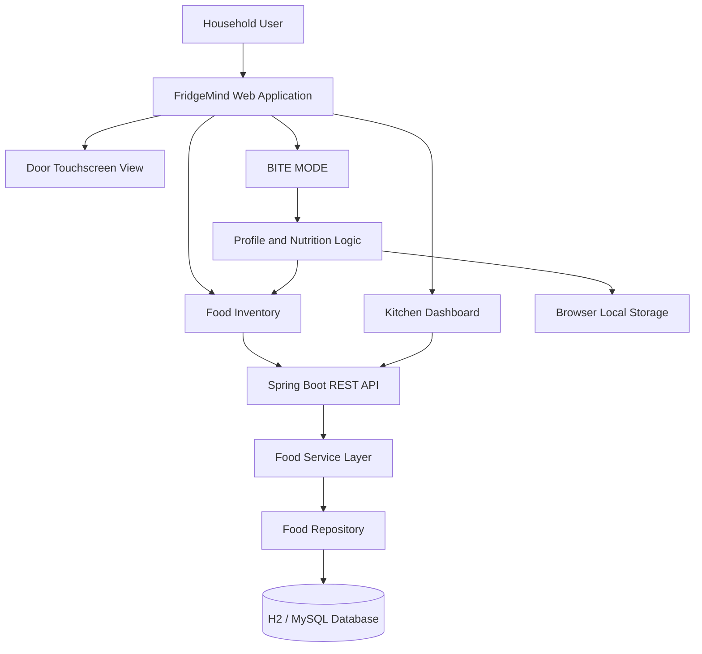
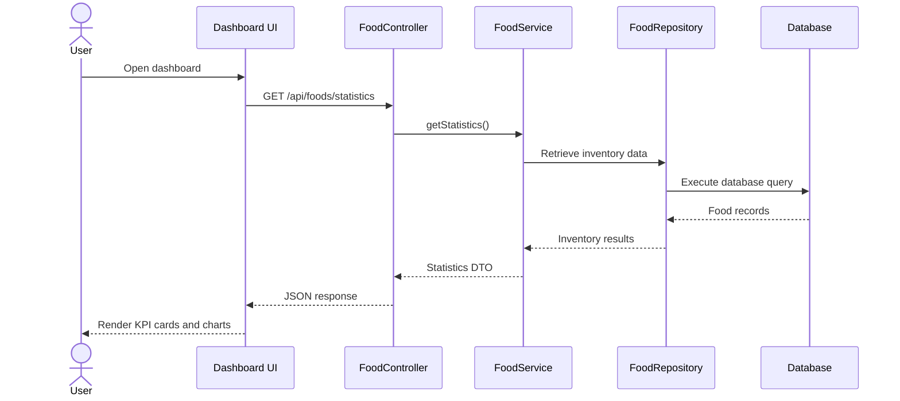
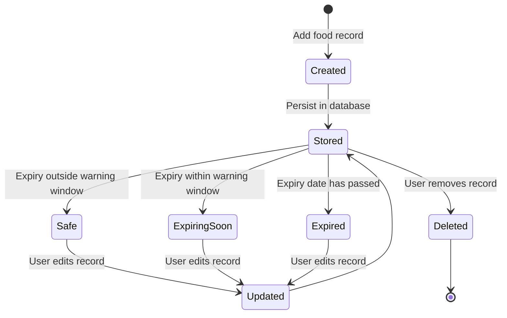
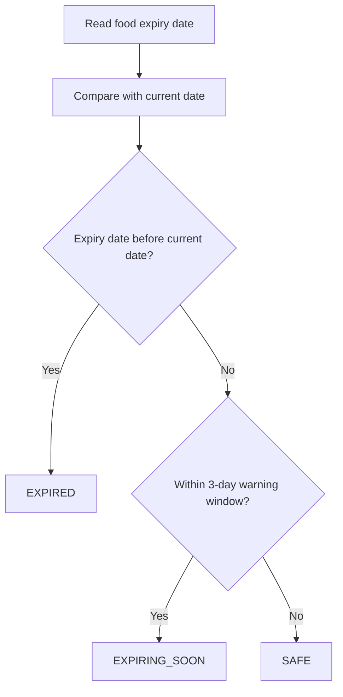
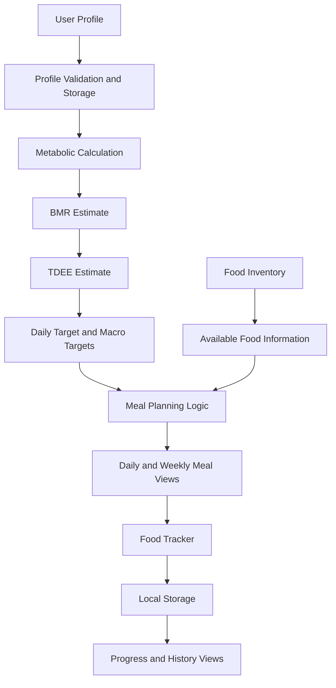
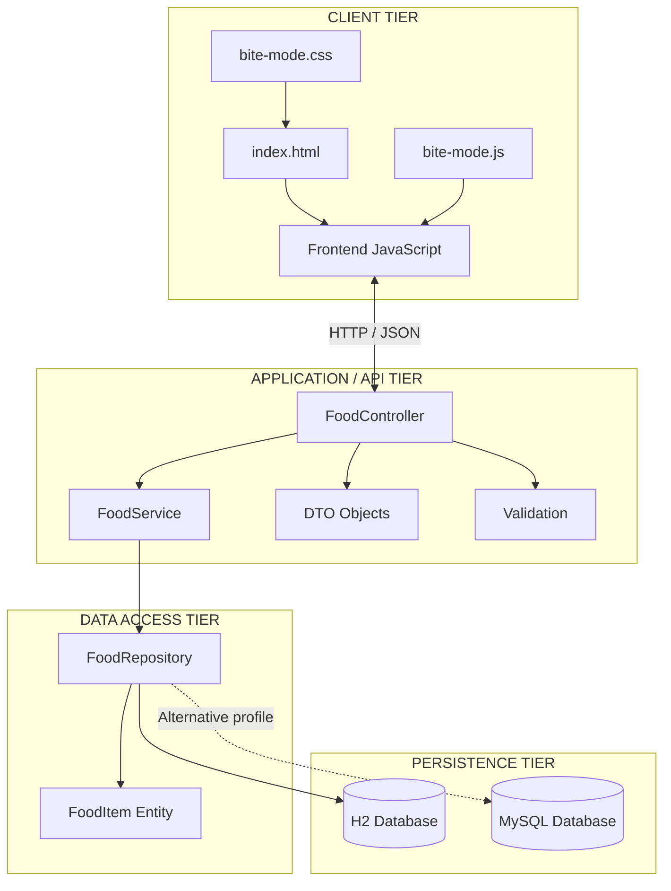
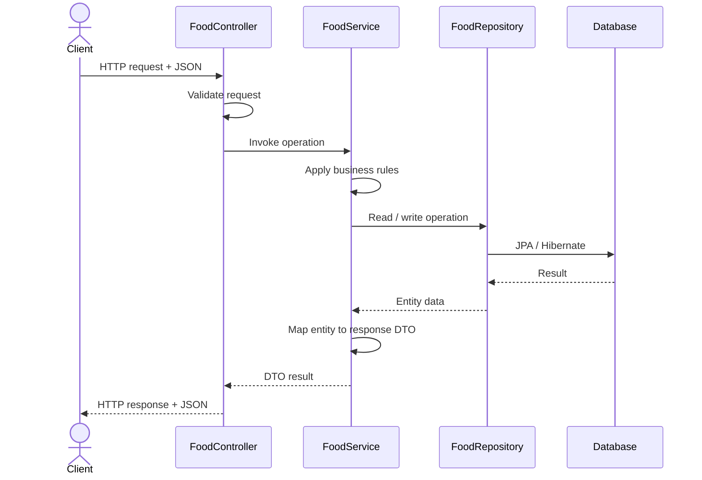
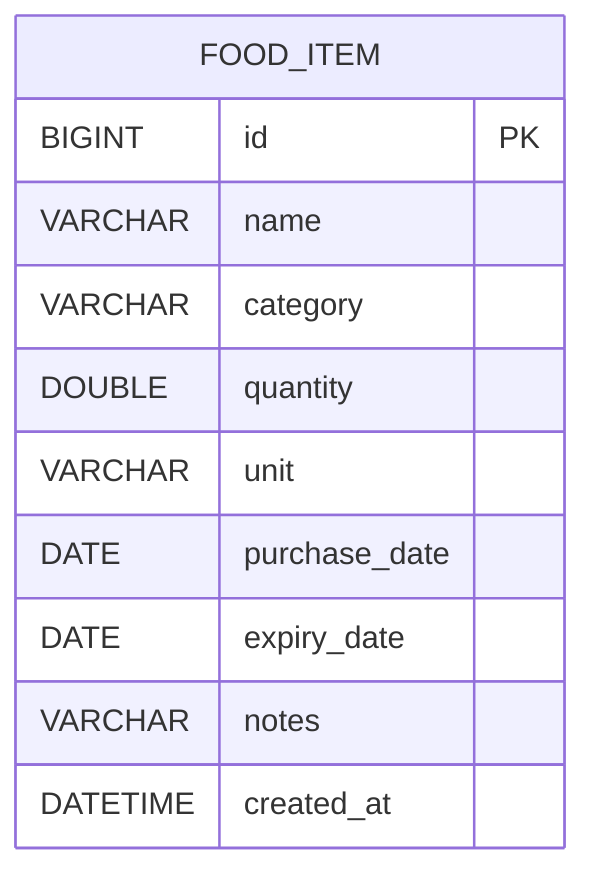
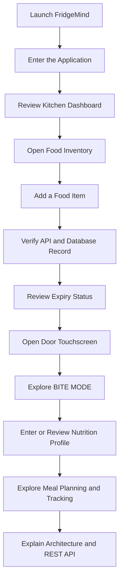
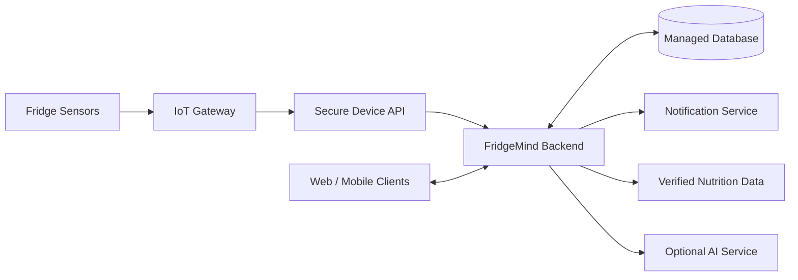

# 🧠 FridgeMind
## Smart Refrigerator Management, Food-Waste Intelligence & Personal Nutrition Platform

<p align="center">
  <b>A full-stack academic software prototype for intelligent household food management.</b><br/>
  <i>Track what you store. Understand what needs attention. Plan meals around what you already have.</i>
</p>

<p align="center">
  
  
  
  
  
  
</p>

---

# 1. Executive Overview

**FridgeMind** is a full-stack smart-kitchen software prototype designed to improve the way households record, monitor, and use food stored inside a refrigerator. The system combines a browser-based user interface with a Java Spring Boot REST API and a relational persistence layer.

The central idea is straightforward: food should not become invisible simply because it has been placed inside a refrigerator. FridgeMind maintains a digital inventory of food items, records their quantities and important dates, calculates expiry status, and presents the information through a visual dashboard. It also includes a refrigerator-door touchscreen concept and a separate nutrition-focused workspace called **BITE MODE**.

The project is organised around three connected areas:

1. **Food inventory intelligence** – recording food items, quantities, categories, purchase dates, expiry dates and notes.
2. **Expiry and household awareness** – classifying stored items as safe, expiring soon or expired, and presenting summary statistics.
3. **Nutrition and meal-planning support** – using a profile, dietary preferences and available food information to support meal planning, food substitutions, food tracking and grocery suggestions.

The application is implemented as a decoupled frontend and backend. The frontend is built with HTML, CSS and vanilla JavaScript. The backend is implemented using Java 21 and Spring Boot 3.3.5. Spring Data JPA provides database access, while H2 is configured as the default database and MySQL is available through a separate Spring profile.

> **Project scope clarification:** This repository contains a software prototype. The refrigerator touchscreen is represented as a browser interface; physical sensors, a real refrigerator controller, automatic barcode scanning and cloud-connected appliance hardware are not included in the current codebase. BITE MODE contains programmed nutrition calculations and rule-based application logic. It should not be represented as a medically validated system or as a trained machine-learning model.

---

# 2. The Problem We Are Addressing

Food management at home often depends on memory. People purchase groceries, store them in different refrigerator compartments and later forget what is available or when it should be consumed. This can lead to avoidable waste, duplicate purchases and poor meal-planning decisions.

FridgeMind approaches this problem as an information-management challenge.

## 2.1 Problem areas

| Problem area | Typical situation | FridgeMind approach |
|---|---|---|
| Forgotten inventory | People forget what is already stored | Maintain a digital food inventory |
| Missed expiry dates | Items remain unused until their expiry date passes | Calculate and display expiry status |
| Poor visibility | Users must inspect shelves manually | Present inventory in a central dashboard |
| Unplanned grocery purchases | Users may purchase items they already have | Make stored inventory easier to review |
| Disconnected meal planning | Meal decisions may ignore available ingredients | Use refrigerator inventory as an input to meal planning |
| Limited nutrition awareness | Users may not have a clear view of meal targets | Provide profile-based nutrition calculations and tracking |

## 2.2 Project objectives

- Develop a structured digital representation of refrigerator inventory.
- Provide CRUD operations for food records through a REST API.
- Calculate remaining days and expiry classifications from stored dates.
- Display inventory summaries and category-level information.
- Provide search, filtering and sorting facilities in the user interface.
- Demonstrate a refrigerator-door touchscreen experience.
- Provide a nutrition workspace that connects meal-planning concepts with stored food.
- Keep the frontend and backend separate so that another client could consume the API in the future.
- Support a low-configuration local demonstration using the H2 database.

## 2.3 Expected outcome

The expected outcome is a working academic prototype that demonstrates how a normal household refrigerator can be represented through software, how inventory data can be processed by a backend service, and how that information can be presented in a user-friendly interface.

---

# 3. Solution Concept

FridgeMind treats the refrigerator as a small inventory system.

Each food record contains information such as:

- Food name
- Food category
- Quantity
- Unit
- Purchase date
- Expiry date
- Optional notes
- Automatically generated record ID and creation timestamp

The backend uses the expiry date to calculate the remaining time and assign a status. The frontend then uses the returned information to display the inventory and highlight items that need attention.

The application also includes BITE MODE, which provides a separate nutrition workflow. It stores a user profile and related tracking information in browser local storage, performs programmed metabolic calculations, and provides meal-planning and food-management interfaces.

## 3.1 High-level concept diagram



---

# 4. Major Modules and Functional Description

## 4.1 Kitchen Control Dashboard

The dashboard is the main overview screen. Its purpose is to make the refrigerator's current inventory understandable without requiring the user to inspect every food record individually.

### Dashboard capabilities

- **Total items:** displays the number of food records in the inventory.
- **Safe items:** displays items whose expiry date is outside the configured warning window.
- **Expiring soon:** highlights food items approaching their expiry date.
- **Expired items:** identifies food whose expiry date has passed.
- **Category distribution:** presents a visual breakdown of food categories.
- **Priority alerts:** separates expired and near-expiry items for quick attention.

The backend exposes a statistics endpoint so the client can request summary information without having to independently calculate every dashboard metric.

### Dashboard data flow



## 4.2 Smart Food Inventory Management

The inventory module is the central data-management component.

### Supported operations

| Operation | Description |
|---|---|
| Add | Create a new food record |
| View | Retrieve all records or one record by ID |
| Update | Modify food details, quantity or dates |
| Delete | Remove a record |
| Search | Find records by partial food name |
| Category filter | Retrieve records belonging to a category |
| Expiry filter | Retrieve expired or expiring-soon records |
| Statistics | Retrieve summary counts and category counts |

### Inventory record lifecycle



The status is calculated dynamically by the service layer from the expiry date. It is not stored as a permanent status field in the `FoodItem` entity. This allows the status to change as calendar days pass without requiring a user to manually edit the record.

### Expiry classification concept



The service defines the statuses `EXPIRED`, `EXPIRING_SOON` and `SAFE`. The expiring-soon API and dashboard use a three-day warning window. The exact result is calculated at request time.

## 4.3 Search, Filtering and Sorting

As an inventory grows, a single long list becomes difficult to use. The interface therefore provides ways to narrow the displayed records.

The project includes:

- Text search by food name.
- Category-based filtering.
- Status-based views such as all, expired, expiring soon and fresh.
- Sorting options for organising the inventory.
- Low-stock-oriented interface functionality.

The backend specifically provides name search and category filtering endpoints. Some presentation-level filtering and sorting is handled by the frontend.

## 4.4 Refrigerator Door Touchscreen Concept

The Door Touchscreen module demonstrates how FridgeMind could be presented on a display attached to a refrigerator door.

The interface contains a refrigerator compartment layout and a pixel-art chef assistant. The visual states include:

- `idle`
- `blink`
- `happy`
- `worried`
- `warn`
- `thinking`

The mascot is a user-interface element intended to make the prototype more approachable. Its visual states can be used to represent normal operation, food warnings and interaction feedback.

The current implementation simulates the touchscreen experience in a web browser. It does not communicate with a physical refrigerator, temperature sensor, humidity sensor or embedded controller. Values shown as appliance telemetry should therefore be understood as interface/demo values rather than readings from connected hardware.

## 4.5 BITE MODE: Personal Nutrition and Meal-Planning Workspace

**BITE MODE** is the nutrition-focused module inside FridgeMind. It connects the idea of food inventory with personal meal planning.

The module includes multiple workflows and is implemented primarily in the frontend JavaScript and browser local storage.

### BITE MODE submodules

| Submodule | Purpose |
|---|---|
| Personal profile | Captures body measurements, goals, activity level and dietary preferences |
| Metabolic calculations | Calculates estimated BMR, TDEE and calorie targets |
| Today's meal plan | Organises meals using available food information |
| Flexible diet mode | Supports different meal preferences and exclusions |
| Food substitution | Compares possible food alternatives and macro differences |
| Grocery recommendations | Presents suggested items for nutritional or meal-planning gaps |
| Weekly planner | Displays a seven-day meal-planning workflow |
| Food tracker | Records planned and consumed meals |
| Nutrition assistant interface | Provides a conversational-style nutrition interface |
| Weight progress | Displays recorded weight history and target progress |

### Metabolic calculation approach

BITE MODE includes the **Mifflin-St Jeor equation** as its programmed BMR calculation method. BMR is an estimate of energy used by the body at rest. TDEE is estimated by applying an activity multiplier to BMR.

The activity multipliers configured in the frontend are:

| Activity level | Multiplier |
|---|---:|
| Sedentary | 1.200 |
| Light | 1.375 |
| Moderate | 1.550 |
| Very active | 1.725 |
| Extremely active | 1.900 |

Conceptually:

```text
Estimated TDEE = Estimated BMR × Activity Multiplier
```

The code also applies calorie-floor rules in its target calculation. These are application rules, not a substitute for personalised medical or dietetic advice.

### BITE MODE data flow



### Important implementation note

BITE MODE uses programmed calculations, application rules, predefined food information and browser-side state. The current project does not include a trained AI model, a machine-learning inference service or a verified clinical decision-support engine. The phrase “AI nutrition assistant” describes the intended interface concept, not proof of a connected generative-AI backend.

Nutrition estimates can vary by food, preparation method, brand and serving size. Users should verify food labels and seek qualified professional advice for medical nutrition decisions.

---

# 5. System Architecture

FridgeMind follows a layered client-server architecture.

## 5.1 Architectural layers

| Layer | Technology | Responsibility |
|---|---|---|
| Presentation layer | HTML5, CSS3, JavaScript | User interface, interaction and visualisation |
| Communication layer | HTTP, JSON, Fetch API | Transfers requests and responses |
| Controller layer | Spring Web | Defines REST endpoints and receives requests |
| Service layer | Java / Spring | Applies application rules and business logic |
| Repository layer | Spring Data JPA | Performs persistence operations |
| Persistence layer | H2 / MySQL | Stores food inventory records |

## 5.2 Component architecture



## 5.3 Why separate frontend and backend?

Separating the frontend and backend provides several engineering benefits:

1. **Separation of concerns:** user-interface code is not mixed with database and business logic.
2. **Independent development:** the interface and API can be changed separately.
3. **Reusability:** a future mobile application or hardware client could consume the same REST API.
4. **Maintainability:** controller, service, repository and entity responsibilities are separated.
5. **Testability:** backend service and controller behaviour can be tested independently.
6. **Deployment flexibility:** the frontend can be served separately or packaged as static resources inside Spring Boot.

---

# 6. Backend Engineering

The backend is built using Java 21 and Spring Boot 3.3.5.

## 6.1 Main backend components

### `FridgeMindApplication`
The Spring Boot entry point responsible for starting the application.

### `FoodController`
Exposes the REST API under `/api/foods`. It receives HTTP requests, validates request payloads and delegates work to the service layer.

### `FoodService`
Contains the main inventory business logic. It creates, retrieves, updates and deletes food records, calculates expiry information and prepares statistics.

### `FoodRepository`
Uses Spring Data JPA to communicate with the database. It extends `JpaRepository` and includes methods for searching by name, filtering by category and grouping records by category.

### `FoodItem`
The JPA entity mapped to the `food_items` database table.

### DTO classes
Data Transfer Objects separate API request and response structures from the persistence entity.

- `FoodItemRequest`
- `FoodItemResponse`
- `FoodStatisticsResponse`
- `ErrorResponse`

### Exception handling
The backend includes a resource-not-found exception and a global REST exception handler to provide structured error responses.

## 6.2 Backend request processing



## 6.3 Data model

The current persistent `FoodItem` entity contains the following fields:

| Field | Type | Purpose |
|---|---|---|
| `id` | Long | Primary key generated by the database |
| `name` | String | Food item name |
| `category` | String | Food category |
| `quantity` | Double | Stored quantity |
| `unit` | String | Quantity unit |
| `purchaseDate` | LocalDate | Date of purchase |
| `expiryDate` | LocalDate | Expiry date |
| `notes` | String | Optional notes |
| `createdAt` | LocalDateTime | Record creation timestamp |

The request DTO validates required text fields, required dates and positive quantity values. The service also validates date relationships before saving records.

### Entity relationship diagram



The current backend data model is intentionally small and centred on the food inventory. BITE MODE profile, food-log and weight-history data are stored in browser local storage rather than in relational tables in the current implementation.

---

# 7. REST API Specification

The backend exposes the following endpoints.

**Base URL:** `http://localhost:8080/api/foods`

| HTTP method | Endpoint | Function |
|---|---|---|
| `GET` | `/api/foods` | Retrieve all food records |
| `POST` | `/api/foods` | Add a food record |
| `GET` | `/api/foods/{id}` | Retrieve one record |
| `PUT` | `/api/foods/{id}` | Update a record |
| `DELETE` | `/api/foods/{id}` | Delete a record |
| `GET` | `/api/foods/search?name=banana` | Search by food name |
| `GET` | `/api/foods/category/{category}` | Filter by category |
| `GET` | `/api/foods/expiring-soon` | Retrieve items in the expiry warning window |
| `GET` | `/api/foods/expired` | Retrieve expired items |
| `GET` | `/api/foods/statistics` | Retrieve inventory statistics |

## 7.1 Example: create a food item

**Request**

```http
POST /api/foods
Content-Type: application/json
```

```json
{
  "name": "Greek Yogurt",
  "category": "Dairy",
  "quantity": 500.0,
  "unit": "grams",
  "purchaseDate": "2026-11-14",
  "expiryDate": "2026-11-28",
  "notes": "Middle shelf"
}
```

**Expected response concept**

The API returns the created food record with its generated ID and calculated expiry information. The controller responds with `201 Created`.

## 7.2 Example: retrieve statistics

```http
GET /api/foods/statistics
```

The response DTO contains:

- `totalItems`
- `safeItems`
- `expiringSoonItems`
- `expiredItems`
- `categoryCounts`

The actual values depend on the records currently stored in the database. Example values should not be interpreted as fixed production metrics.

## 7.3 HTTP status behaviour

| Status | Meaning in this project |
|---|---|
| `200 OK` | Successful retrieval or update |
| `201 Created` | Food record created |
| `204 No Content` | Food record deleted |
| `400 Bad Request` | Invalid request data |
| `404 Not Found` | Requested food record does not exist |
| `500 Internal Server Error` | Unexpected server-side failure |

---

# 8. Frontend Engineering and User Experience

The frontend is a single-page browser application built with standard web technologies.

## 8.1 HTML5
Provides the structural layout for the landing experience, module navigation, dashboard, inventory, touchscreen and BITE MODE.

## 8.2 CSS3
Controls the visual system, layout, colours, typography, responsive arrangements, transitions and animation.

## 8.3 Vanilla JavaScript (ES6+)
Handles user interactions, client-side state, browser storage, API communication and dynamic rendering.

## 8.4 Fetch API
The frontend communicates with the Spring Boot backend using asynchronous HTTP requests. JSON is used as the exchange format.

## 8.5 SVG and CSS visualisations
The interface uses browser-native graphics and styling for visual summaries and progress indicators. These are rendered in the browser and do not require a separate chart-rendering server.

## 8.6 Pixel-art visual assets
The repository includes several chef mascot sprite images, including idle, blink, happy, worried, warning and thinking states. The images support the visual identity of the touchscreen experience.

---

# 9. Data Storage Strategy

FridgeMind uses two storage approaches for different responsibilities.

| Data | Storage location | Reason |
|---|---|---|
| Refrigerator food inventory | H2 or MySQL through Spring Data JPA | Persistent server-side inventory |
| BITE MODE profile | Browser local storage | Client-side profile persistence |
| BITE MODE food log | Browser local storage | Client-side meal tracking |
| BITE MODE weight history | Browser local storage | Client-side progress history |
| Current meal plan | Browser local storage | Client-side plan persistence |

## 9.1 H2 database

H2 is the default database profile. It allows the project to run locally without requiring a separately installed database server.

Configured database URL:

```text
jdbc:h2:file:./data/fridgemind_h2
```

The H2 console is enabled at:

```text
http://localhost:8080/h2-console
```

## 9.2 MySQL profile

The project also includes a MySQL configuration. It can be activated through the `SPRING_PROFILES_ACTIVE` environment variable. Database host, port, name, username and password are configurable through environment variables.

This gives the project a path from a simple local academic demonstration to a more conventional relational database deployment.

---

# 10. Validation, Reliability and Error Handling

Reliable inventory management requires more than displaying records. The application includes validation and error-handling mechanisms in the backend.

Examples include:

- Food name cannot be blank.
- Category cannot be blank.
- Quantity is required and must be greater than zero.
- Unit cannot be blank.
- Purchase date and expiry date are required.
- Date validation is performed before an item is saved or updated.
- Requests for missing food IDs result in a resource-not-found exception.
- A global exception handler standardises API error responses.

These checks help prevent incomplete or invalid inventory records from entering the database.

---

# 11. Testing

The backend repository contains test source files for service-level and controller-level testing.

| Test file | Intended responsibility |
|---|---|
| `FoodServiceTest.java` | Tests service behaviour and inventory business rules |
| `FoodControllerIntegrationTest.java` | Tests controller/API behaviour through integration testing |

Run the test suite from the `backend` directory:

```bash
mvn test
```

Build the backend:

```bash
mvn clean package
```

A successful build confirms that Maven can compile and package the backend with its configured dependencies. Test results should be checked in the terminal during evaluation.

---

# 12. Technology Stack and Why It Was Selected

| Technology | Role in FridgeMind | Reason for use |
|---|---|---|
| Java 21 | Backend programming language | Strong typing, mature ecosystem and modern LTS release |
| Spring Boot 3.3.5 | Backend framework | Simplifies REST API development and application configuration |
| Spring Web | HTTP layer | Provides REST controllers and JSON endpoints |
| Spring Data JPA | Data access | Reduces repetitive persistence code |
| Hibernate | ORM implementation | Maps Java entities to relational database tables |
| Jakarta Validation | Input validation | Declarative request validation |
| H2 | Default database | Simple local setup and demonstration |
| MySQL Connector/J | MySQL connectivity | Supports an external MySQL database profile |
| Apache Maven | Build and dependency management | Reproducible backend builds |
| HTML5 | Frontend structure | Semantic browser-based interface |
| CSS3 | Frontend styling | Layout, visual design and animation |
| JavaScript ES6+ | Frontend behaviour | Client-side logic and asynchronous API calls |
| Browser Local Storage | BITE MODE persistence | Retains selected client-side information between sessions |
| Mermaid | Documentation diagrams | Describes architecture and workflows in version-controlled Markdown |

---

# 13. Repository Structure

```text
FridgeMind/
│
├── README.md
├── .gitignore
├── .env.example
│
├── frontend/
│   ├── index.html
│   ├── bite-mode.css
│   ├── bite-mode.js
│   ├── package.json
│   └── assets/
│       ├── pixel_chef.png
│       ├── pixel_chef_idle.png
│       ├── pixel_chef_blink.png
│       ├── pixel_chef_happy.png
│       ├── pixel_chef_worried.png
│       ├── pixel_chef_warn.png
│       └── pixel_chef_thinking.png
│
└── backend/
    ├── pom.xml
    ├── data/
    └── src/
        ├── main/
        │   ├── java/com/fridgemind/backend/
        │   │   ├── FridgeMindApplication.java
        │   │   ├── config/
        │   │   ├── controller/
        │   │   ├── dto/
        │   │   ├── entity/
        │   │   ├── exception/
        │   │   ├── repository/
        │   │   └── service/
        │   │
        │   └── resources/
        │       ├── application.properties
        │       ├── application-h2.properties
        │       ├── application-mysql.properties
        │       └── static/
        │
        └── test/
            ├── java/com/fridgemind/backend/
            └── resources/
```

The `backend/src/main/resources/static/` directory contains a copy of the frontend files so Spring Boot can serve the web application directly. The separate `frontend/` directory is retained for independent frontend development and serving.

---

# 14. Installation and Execution Guide

## 14.1 Prerequisites

Install the following:

- Java Development Kit (JDK) 21
- Apache Maven 3.8 or later
- A modern web browser
- Optional: Node.js for the frontend's `serve` command
- Optional: MySQL Server if using the MySQL profile

Verify Java and Maven:

```bash
java -version
mvn -version
```

## 14.2 Start the backend

Open a terminal in the project root:

```bash
cd backend
mvn spring-boot:run
```

The backend should start on:

```text
http://localhost:8080
```

Check the API:

```text
http://localhost:8080/api/foods
```

Check statistics:

```text
http://localhost:8080/api/foods/statistics
```

## 14.3 Open the application directly through Spring Boot

Because the frontend is also included in Spring Boot's static resources, open:

```text
http://localhost:8080
```

This is the simplest demonstration method because the frontend and backend are served from the same application origin.

## 14.4 Run the frontend separately (optional)

Open a second terminal:

```bash
cd frontend
```

Using Python:

```bash
python -m http.server 3000
```

Then open:

```text
http://localhost:3000
```

Alternatively, when Node.js is installed:

```bash
npm start
```

The backend should remain running on port `8080` while using the separately served frontend.

## 14.5 Switch to MySQL (optional)

Create a database:

```sql
CREATE DATABASE fridgemind_db;
```

Set the environment variables in PowerShell:

```powershell
$env:SPRING_PROFILES_ACTIVE="mysql"
$env:DB_HOST="localhost"
$env:DB_PORT="3306"
$env:DB_NAME="fridgemind_db"
$env:DB_USERNAME="root"
$env:DB_PASSWORD="your_password"
```

Then start the backend:

```bash
mvn spring-boot:run
```

Use a private local password. Do not commit database credentials to GitHub.

---

# 15. Demonstration Workflow

A suggested project demonstration can follow this order:



### Suggested live demonstration

1. Start the backend and open the application.
2. Explain the dashboard and its inventory summary.
3. Add a sample food item with a purchase date and expiry date.
4. Show how the record appears in the inventory.
5. Demonstrate search and category filtering.
6. Show the expiring-soon and expired views.
7. Open the touchscreen concept and explain the mascot states.
8. Open BITE MODE and explain profile-based calculations.
9. Demonstrate the meal-planning, food tracking and progress interfaces.
10. Finish by explaining the REST API and database architecture.

---

# 16. Current Implementation Boundaries

This section is included to make the technical scope precise.

| Capability | Current project status |
|---|---|
| Browser-based dashboard | Implemented |
| Food inventory CRUD API | Implemented |
| H2 database configuration | Implemented |
| MySQL configuration | Included |
| Search and category API | Implemented |
| Expiry classification | Implemented in backend service |
| Dashboard statistics API | Implemented |
| Browser-based door touchscreen concept | Implemented as interface |
| Pixel chef visual states | Included as frontend assets |
| BITE MODE interface and workflows | Implemented in frontend |
| BMR/TDEE calculation logic | Programmed in frontend |
| BITE MODE browser persistence | Implemented with local storage |
| Physical refrigerator sensor integration | Not included |
| Automatic barcode / camera recognition | Not included |
| Cloud-hosted deployment | Not included in this repository |
| Trained machine-learning model | Not included |
| External generative-AI API integration | Not included in current backend |

This distinction matters in an academic review: the project demonstrates the software architecture and user workflows for a smart refrigerator platform, while hardware integration and external AI services remain possible future extensions.

---

# 17. Future Scope and Enhancement Roadmap

FridgeMind has been structured so that additional capabilities can be developed in stages.

## Phase 1 — Core software refinement
- Improve automated test coverage.
- Add pagination for large inventories.
- Add stronger filtering and sorting at API level.
- Add user authentication and role-based access.
- Improve API documentation with OpenAPI/Swagger.
- Add structured application logging and monitoring.

## Phase 2 — Inventory intelligence
- Add barcode-based product entry.
- Add image-assisted food recognition.
- Add configurable expiry warning periods.
- Add storage-location management.
- Add stock consumption and quantity decrement workflows.
- Add shopping-list generation from low-stock items.

## Phase 3 — Nutrition data integration
- Connect a maintained food-nutrition data provider.
- Store serving sizes and nutrient values with clear provenance.
- Improve recipe matching against actual available ingredients.
- Add allergy and dietary constraint validation.
- Add meal-plan export and user-controlled targets.

## Phase 4 — AI-assisted capabilities
- Integrate a real language model through a controlled backend service.
- Ground assistant responses in the user's inventory and verified nutrition data.
- Add retrieval and source attribution for nutrition information.
- Evaluate generated meal suggestions for ingredient availability and dietary constraints.
- Add safeguards against presenting generated content as medical advice.

## Phase 5 — IoT and smart appliance integration
- Connect temperature and humidity sensors through a microcontroller.
- Design a secure device-to-server communication protocol.
- Synchronise refrigerator telemetry with the application.
- Add device status and connectivity monitoring.
- Evaluate notification delivery for expiry and temperature events.

## Phase 6 — Deployment and scalability
- Containerise the application with Docker.
- Configure environment-specific deployment profiles.
- Deploy the API and database to a managed environment.
- Add CI/CD checks for build and test execution.
- Add backup, recovery and database migration procedures.

### Future architecture concept



The diagram represents a possible future architecture. These external services and hardware devices are not part of the current repository.

---

# 18. Security and Responsible Use Considerations

The current code is an academic prototype and should be hardened before public or production deployment.

Recommended improvements include:

- Replace permissive cross-origin settings with an explicit trusted-origin list.
- Add authentication and authorisation before storing personal profiles on a shared server.
- Store secrets in environment variables or a secret manager.
- Use HTTPS in deployed environments.
- Validate and constrain all incoming data.
- Avoid exposing database consoles publicly.
- Define retention and deletion policies for personal data.
- Treat nutrition outputs as estimates, not medical diagnosis or treatment.
- Verify food safety information independently; an expiry-date reminder cannot determine whether food is safe to consume.

---

# 19. Academic Learning Outcomes

The project brings together concepts from several areas of computer science and software engineering.

| Area | Concepts demonstrated |
|---|---|
| Object-oriented programming | Java classes, entities, DTOs and service classes |
| Backend development | REST controllers, request mapping and response handling |
| Database systems | Relational persistence, entity mapping and repository operations |
| Software architecture | Layered architecture and separation of concerns |
| Web development | HTML, CSS, JavaScript and browser-based interaction |
| API engineering | HTTP methods, JSON payloads and status codes |
| Data validation | Required fields, positive quantity and date checks |
| Testing | Unit tests and controller integration tests |
| Data visualisation | Dashboard summaries, charts and progress indicators |
| Application design | Modular screens and user workflows |
| Persistence | H2/MySQL configuration and browser local storage |

---

# 20. Conclusion

FridgeMind demonstrates how a familiar household appliance can be supported by a structured software system. It combines a visual kitchen dashboard, a digital food inventory, expiry-status processing, a refrigerator touchscreen concept and a nutrition-oriented workspace.

From an engineering perspective, the project demonstrates a separation between the browser client, REST API, service layer, repository layer and relational database. It also demonstrates how a single application can combine persistent server-side inventory data with selected client-side workflows.

The broader direction is to evolve FridgeMind from an inventory-management prototype into a connected smart-kitchen platform. Future development can introduce verified nutrition integrations, genuine AI-assisted recommendations, physical IoT sensors, secure multi-user accounts and deployment infrastructure.

**FridgeMind's core principle: make stored food visible, make expiry information actionable, and make meal planning more aware of what is already available.**

---

# 21. Team and Project Information

**Project:** FridgeMind – Smart Refrigerator Management System  
**Project type:** Academic full-stack software prototype  
**Frontend:** HTML5, CSS3, JavaScript  
**Backend:** Java 21, Spring Boot 3.3.5  
**Database:** H2 by default, MySQL profile available  
**Build tool:** Apache Maven  

---

# 22. License

This project currently declares the MIT License in its frontend package metadata. If the repository is to be distributed under the MIT License, include a complete `LICENSE` file at the project root and confirm that all third-party assets and data sources permit the intended use.

---

<p align="center">
  <b>FridgeMind</b><br/>
  <i>From refrigerator inventory to informed kitchen decisions.</i>
</p>
